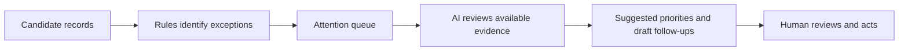

# AI Recruitment Operations Agent

**Turning recruitment follow-up into a structured, reviewable workflow**

Recruitment across a distributed workforce involves more than screening applications. Hiring managers need to respond, candidate records need to be complete, and someone has to keep track of what is waiting on whom. When this work sits across inboxes and spreadsheets, delays are easy to miss.

I built and put into production an AI-assisted recruitment operations workflow to surface coordination issues automatically, while keeping decisions and external communications under human control.

> **Status:** In production. The technical testing described below used 10 fictional candidate records; those test records should not be confused with live recruitment data. Any time savings below are illustrative estimates, not measured results.

## At a glance

| | |
| --- | --- |
| **Business challenge** | Recruitment coordination depends on repeatedly checking candidate status, outstanding information and hiring-manager feedback |
| **Solution** | Rules-based checks paired with an AI assistant that investigates issues, prioritises next steps and prepares draft follow-ups |
| **My role** | Defined the operational problem, designed the workflow, built and tested the application and AI integration |
| **Safeguards** | Fictional test data, server-held API keys, validated tool actions, bounded agent execution and human approval before communications |
| **Technology** | TypeScript, AI tool calling via an OpenAI-compatible provider, automated tests |
| **Evidence** | Production use, with working end-to-end tool calling; 34 tests and build passing at the recorded development checkpoint |

## The operational problem

Recruitment creates many small administrative dependencies. A candidate may be waiting for feedback, a hiring manager may not have been assigned, or information required to progress an application may still be missing. Individually these are straightforward; across a busy hiring campaign they compete for attention.

The goal was to reduce time spent searching for exceptions and composing routine follow-ups, so the person coordinating recruitment could focus on resolving blockers.

## What the system looks like in practice

The accompanying three-page product walkthrough illustrates the workflow using **10 fictional candidate records**:

| Screen | Operational value |
| --- | --- |
| **Candidate pipeline** | A single view of candidate stage, hiring manager, interview dates, feedback deadlines and last activity, with headline counts of missing owners, overdue feedback, incomplete records and stalled stages |
| **Attention needed** | Deterministic checks produce a consistent, prioritised exception queue with the reason for each flag and a suggested next action |
| **Ask the agent to investigate** | An optional AI agent reviews the pipeline, identifies the three most important issues, explains urgency, business impact and uncertainty, and prepares editable follow-up drafts |

The third screen is particularly useful evidence of the system's design: the agent's response shows **priorities, supporting evidence, why each issue matters, a proposed action and a draft communication**. The user can edit, copy, discard or approve the draft locally. The demonstration explicitly indicates that no emails were sent.

The sample also shows why combining rules with AI is useful. A missing hiring manager is flagged deterministically, but the AI can explain why that missing ownership blocks progress and recommend a coordinator-led verification rather than assigning someone automatically.

*The screenshots use synthetic records and demonstrate functionality; they are not a claim about live candidate counts or achieved recruitment outcomes.*

## How I approached it

### 1. Translate operational issues into explicit checks

I started with a fictional candidate dataset and defined deterministic rules for issues such as:

- Overdue hiring-manager feedback
- Missing candidate or process information
- Candidates stalled in a stage for more than seven days

The checks identify what needs attention. This matters because a language model should not be the sole source of truth for whether a deadline has been missed.

### 2. Build an actionable queue

The application groups findings into an attention queue rather than leaving the user to inspect every candidate individually. The interface also includes a dashboard and draft queue, so an issue can move from identification to a proposed next action.

### 3. Add an AI assistant with narrow tools

The assistant can use defined functions to list candidates, inspect attention items and create follow-up drafts. Its role is to interpret the operational context, help identify priorities and prepare communications for review—not to make hiring decisions.

### 4. Put limits around the automation

The implementation keeps provider credentials on the server and validates tool actions. Agent runs are bounded to prevent uncontrolled loops. Drafts remain drafts: the agent does not autonomously send emails, reject applicants or make hiring decisions.

## Implementation and testing

The application successfully completed an end-to-end AI tool-calling flow and passed 34 tests and its build at a recorded development checkpoint. The workflow is now used in production.

The build combined deterministic checks for operational exceptions with constrained AI tool use and a human-review step for drafted communications. Testing covered the end-to-end tool-calling workflow and application build, with 34 tests passing at the recorded checkpoint.

The design deliberately separates identifying a recruitment blocker from recommending how to resolve it. This keeps the assistant focused on actionable coordination rather than allowing it to make hiring decisions or send messages independently.

## Potential operational impact

For planning purposes, I modelled a recruitment coordination task falling from **2 hours to 30 minutes per week**. That would represent **90 minutes of potential weekly capacity**, or **18 hours over a 12-week campaign**.

**This is a scenario estimate, not an observed saving.** A measured baseline and comparison of time spent would be needed before presenting this estimate as an achieved saving.

## Future development opportunities

The production workflow provides a foundation for extending recruitment operations intelligence. Areas for future development include:

1. **Recruitment performance reporting:** trends in time-to-feedback, stage progression and recurring bottlenecks.
2. **More proactive coordination:** configurable reminders and escalation thresholds tailored to different hiring campaigns.
3. **Deeper system integration:** connect relevant recruitment and people workflows to reduce manual hand-offs.
4. **Management insight:** summarise workload, outstanding dependencies and campaign progress across teams.
5. **Continuous evaluation:** use operational feedback and measured outcomes to guide further refinements.

These are potential extensions to the existing workflow, not prerequisites for its current use.

## Why this project matters

This project is an example of applying AI to a specific operational problem: understand the work, define reliable rules, introduce AI only where interpretation or drafting helps, and test the whole workflow against the realities of daily use.

It also reinforced an important lesson: the quality of an AI-enabled process depends as much on exception handling, ownership and human judgement as on the model itself.

---

[← Back to portfolio](../README.md) · [Operations CRM case study](operations-crm.md)
