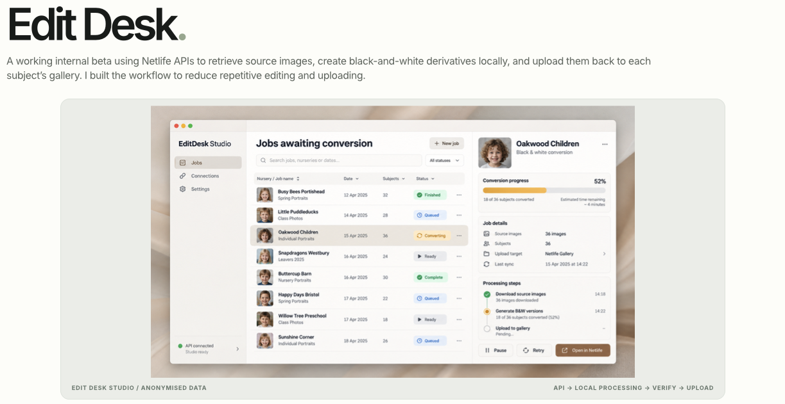
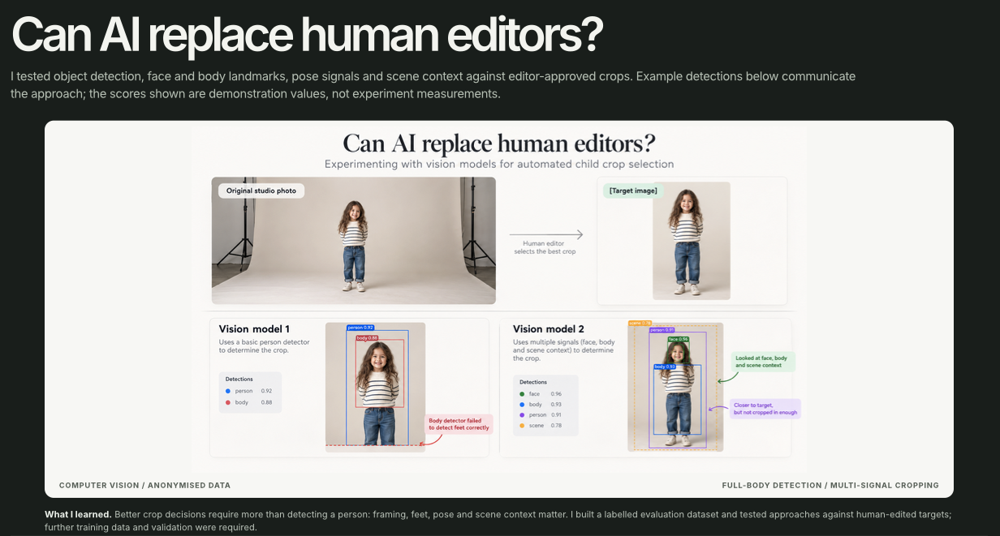

# Image Editing Automation & AI Vision Experiment

**Production image-processing automation, alongside a measured computer vision experiment**

Photographic production involves thousands of repetitive decisions: retrieving source images, preparing alternative versions, uploading the right outputs and choosing crops that preserve the intended composition. I worked on two related initiatives to reduce manual processing while maintaining editorial control and data protection.

| Initiative | Status | Focus |
| --- | --- | --- |
| **EditDesk — black-and-white image automation** | **Running in production** | Netlife API integration, local image processing and gallery upload |
| **AI vision crop selection** | **Research and evaluation experiment** | Testing whether computer vision can approach human-approved cropping decisions |

## 1. EditDesk — automating image editing

The existing workflow required repetitive preparation of black-and-white versions of photographs. I built an automation around the **Netlife APIs** to retrieve source images, generate black-and-white derivatives **locally on the machine**, and upload the resulting files back to the relevant subject galleries.

The process is designed around a straightforward production sequence:

1. Identify the job and source images through the existing gallery system.
2. Retrieve the images needed for conversion.
3. Produce black-and-white derivatives on the local machine rather than editing images in a cloud processing service.
4. Check processing status and return the output to the appropriate gallery.
5. Keep the workflow visible to an operator, including progress and exceptions.

**Business impact:** the production automation reduced proofing time by removing repetitive black-and-white editing and upload steps. Making black-and-white alternatives available in the gallery also helped increase average order value. The workflow retains the existing ordering and gallery environment as the system of record. The black-and-white automation is **in production**.

### EditDesk interface

The image below illustrates the workflow and job-progress interface. It uses anonymised/example data.

*EditDesk: local image processing and Netlife gallery workflow.*

## 2. AI vision experiment — can automated cropping match a human editor?

Cropping is a harder problem than applying a fixed image transformation. A person can be correctly detected, yet the resulting crop can still be wrong: feet may be cut off, the subject may be poorly positioned, or the frame may lose important scene context.

I investigated whether open-source computer vision techniques could make crop selection more consistent and reduce the amount of manual review required.

### Techniques explored

- **Object and person detection:** locate the subject and establish an initial bounding region.
- **Face detection and facial landmarks:** identify the head and facial position, informing composition and safe margins.
- **Body landmarks and pose estimation:** understand the subject's extent and posture, including whether a full-body crop needs to preserve the feet.
- **Scene and framing context:** consider the surrounding image, not just the highest-confidence detection box.
- **Candidate crop generation:** create a small set of plausible crops rather than treating one detector output as the answer.
- **Candidate ranking:** compare crop alternatives against composition constraints and reference examples.
- **Quantitative evaluation:** compare predictions with human-approved target crops using intersection-over-union (IoU), alongside orientation checks.

A central learning was that **high detection confidence is not the same as a good editorial crop**. A model may identify the person correctly and still produce framing that a human editor would reject.

### Evaluation

The experiment used a labelled evaluation set of **synthetic, fake image data**, handled locally. The training and evaluation work was kept local rather than sending photographs to a cloud image-editing service.

At a recorded Stage 5 evaluation checkpoint, the hybrid approach achieved:

| Evaluation metric | Recorded result |
| --- | ---: |
| Mean crop IoU | **0.7971** |
| Improvement against the comparison baseline | **+0.0362** |
| Orientation accuracy | **90.7%** |

These are **experimental evaluation results**, not a claim that automated cropping replaced production editors or met a final deployment threshold. IoU measures geometric overlap with a reference crop; it is not itself a complete measure of editorial quality.

### Vision experiment visual

The visual compares the original studio image, the human-selected target and two detection approaches. The confidence values displayed in the illustration are **demonstration values, not measured experiment scores**.

*AI vision experiment: visual comparison of crop-selection approaches.*

## 3. Operational approach and safeguards

These projects were approached as practical operational changes, not simply AI demonstrations:

- **Local processing:** image transformations ran on the machine rather than through a third-party cloud editing service.
- **Synthetic experimental data:** model experimentation and evaluation used fake test imagery, rather than training on identifiable customer photographs.
- **Existing system integration:** EditDesk works with the established Netlife gallery workflow.
- **Human editorial judgement:** the crop-selection work was evaluated against human-approved targets, with remaining gaps made visible rather than hidden behind a confidence score.
- **Separate deployment claims:** the black-and-white workflow is in production; AI crop selection remains an experiment.

## What this demonstrates

I can identify repetitive work in an operational environment, integrate with an existing platform, build local processing workflows and test more advanced AI approaches against measurable standards. Equally importantly, I can distinguish **a reliable production automation** from **an AI experiment that still needs validation** before it should replace human judgement.

*This case study describes my work and methods without publishing employer source code, credentials or customer image data.*
