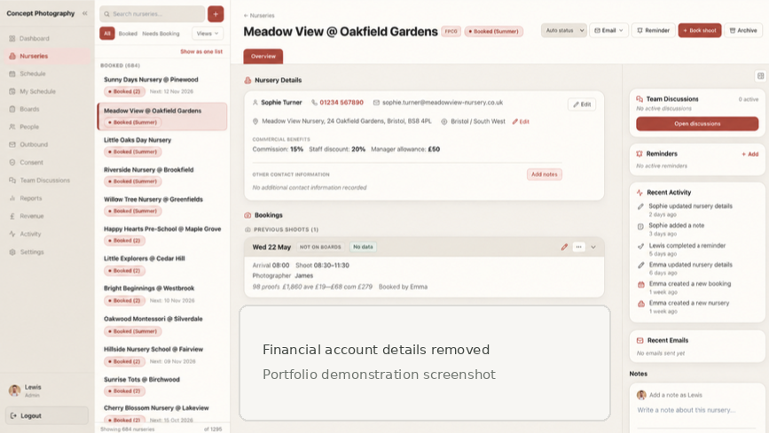
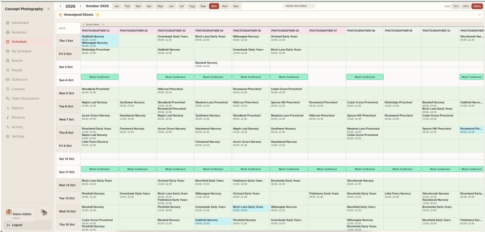
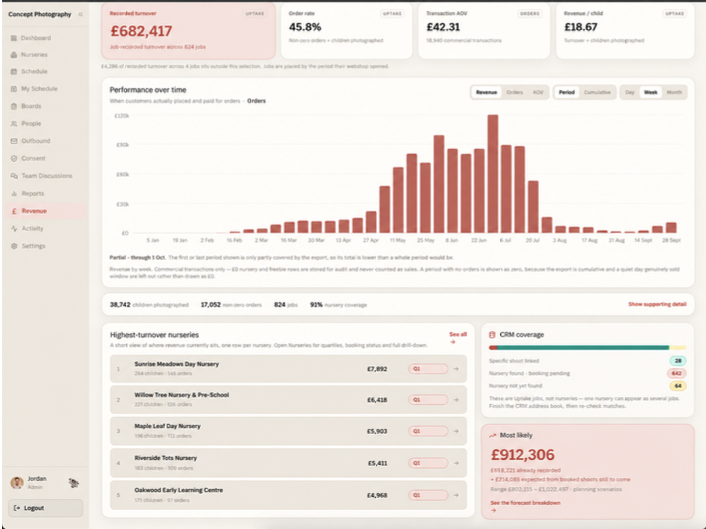
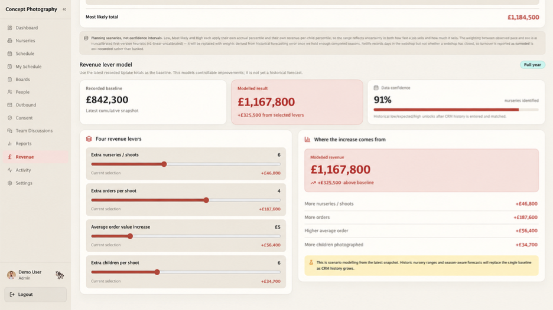

# Operations CRM & Workflow Transformation

**From disconnected spreadsheets to a shared system for bookings, scheduling and performance reporting**

I led the redesign of booking administration for a nursery photography operation and built an internal CRM around how the team actually worked. The aim was to reduce repeated data entry, make outstanding work visible and give managers reliable information for day-to-day decisions.

## Results

| Measure | Before | After |
| --- | --- | --- |
| Typical booking administration | Approximately 4–5 minutes | Around 1 minute |
| Time spent per booking | — | **Approximately 75–80% lower** |
| Annual capacity released | — | **Estimated 100–133 hours**, across roughly 2,000 bookings |

## The problem

Booking details lived in multiple Google Sheets and a separate contacts application. Staff repeated entries, prepared emails manually and checked different places to see what had been completed. This was particularly difficult during seasonal peaks, when bookings, photographers and production deadlines all needed coordinating.

Off-the-shelf CRMs added complexity without fitting the way this business operated. I wanted one place for a nursery's history, its bookings, the next action and the information needed to manage performance.

## My role and the solution

I mapped the booking and follow-up processes, identified duplicated work, designed the new workflows and developed the application. I also worked through testing and iteration as the team began using it.

The platform brought together:

- **Client and booking records:** nursery details, booking history, notes, assigned actions and activity logs.
- **Operational coordination:** field scheduling, progress boards, overdue items and reminders.
- **Communications:** booking confirmations and follow-up workflows supported by shared information rather than repeated manual entry.
- **Commercial reporting:** booking targets, year-on-year comparisons, revenue dashboards, client quartiles, average order value and order rate.

Built using **Next.js, TypeScript and Supabase (PostgreSQL, authentication and row-level security)**. The application was developed for a multi-user operation with different staff permissions.

### What changed

| Previously | With the CRM |
| --- | --- |
| Booking details entered in several systems | One shared booking record and history |
| Updates and next steps checked manually | Clear statuses, ownership, reminders and outstanding actions |
| Separate information needed for scheduling | A shared field schedule linked to the booking workflow |
| Limited ability to compare performance | Structured reporting across clients, booking targets and revenue |

Staff could see who owned the next action without checking several different tools.

## Platform walkthrough

These screenshots contain fictional demonstration records and figures.

### Client record

The nursery record brings together booking history, notes, reminders and related activity.

### Field scheduling

The schedule gives office staff a shared view of assignments and booking activity.

### Revenue reporting

Client and staff performance can be reviewed using average order value, order rate, targets and comparisons over time.

### Scenario modelling

Managers can test assumptions about potential revenue improvements. **Modelled scenarios are not claimed as achieved results.**

## Testing, security and release discipline

Because the application supports live operational records and communications, reliability and access control were part of development rather than added at the end.

**Functional and smoke testing.** The project used automated Vitest checks and a Playwright browser harness. Smoke checks covered login, the dashboard, client navigation and the booking flow. More involved end-to-end checks exercised booking creation, scheduling visibility and navigation consistency. Type checking, linting and regression tests supported release reviews.

**Security review and remediation.** I used Claude Code to support structured reviews of authentication, Supabase row-level security, API permissions, PostgreSQL function privileges and activity-log integrity. Reviews were followed by practical fixes and role-based tests, including attempts to perform actions or attribute changes outside the user's permissions.

**Database hardening.** One review phase addressed the configuration and execution privileges of **15 database functions**. A broader least-privilege review covered **40 tables**, with validation recorded in staging; deployment and production verification were tracked separately. Selected access-control changes were also checked against production roles.

**Traceability and privacy.** Role-based permissions, activity history and shared statuses make hand-offs more accountable. Production source code and business records remain private; the images here are fictional demonstrations.

## Operational and commercial value

The immediate benefit was less time entering and reconciling bookings. The same underlying records also made it easier to see which clients needed attention, coordinate a seasonal team and investigate commercial performance without combining separate spreadsheets.

I owned the work across process design, product development and operational adoption. It was an operational improvement project first, with software built to support it.

---

[← Back to portfolio](../README.md) · [Recruitment agent](ai-recruitment-operations-agent.md) · [Image automation and AI vision](image-editing-automation-ai-vision.md)
