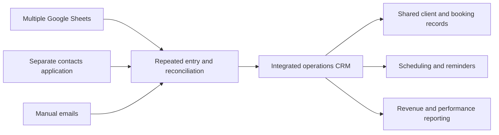

# Operations CRM & Workflow Transformation

**Operational improvement · Process redesign · Systems development · Change management**

> **The objective:** Replace fragmented booking administration with a simpler operational platform that improves accuracy, makes work easier to manage and enables commercial performance analysis.

## At a glance

| Measure | Outcome |
| --- | --- |
| Booking administration | Reduced from approximately 4–5 minutes to around 1 minute per booking |
| Estimated time reduction | Approximately 75–80% per booking |
| Annual booking volume used for estimate | Approximately 2,000 |
| Estimated annual capacity released | Approximately 100–133 administration hours |

Time saved is calculated from the difference in approximate handling time multiplied by annual booking volume.

## The operational problem

Bookings were entered manually across multiple Google Sheets and a separate contacts application, with emails also prepared manually. This created three connected operational problems:

1. **Time-consuming administration.** Entering one booking across several systems repeated work and took approximately 4–5 minutes.
2. **Multiple sources of truth.** Records could become inconsistent across systems, with opportunities for human error both when entering bookings and when preparing emails.
3. **Limited performance insight.** Legacy applications made it difficult to extract usable data for reporting, trend analysis and future operational decisions.
4. **Unnecessary complexity in alternatives.** Conventional CRMs offered more complexity than the team needed for its booking, reminder and operational workflows.

The goal was therefore broader than replacing spreadsheets: **reduce administrative effort, improve data consistency and establish a reliable foundation for operational reporting and improvement.**

### Before and after

| Before: fragmented workflow | After: integrated operational platform |
| --- | --- |
| Re-enter booking details across Google Sheets and a contacts application | Centralised booking records and history |
| Multiple records to reconcile and manually prepared emails | Shared records and communication workflows supported by the system |
| Limited ability to extract data for analysis | Structured operational data and dashboards |
| Progress checked across different tools | Shared dashboards, task ownership and workflow visibility |

*The comparison describes the workflow redesign; it does not imply every communication is fully automated or that errors have been eliminated.*

## Approach: understand, map, improve, implement, measure

### 1. Understand and map the work

Reviewed how bookings moved from initial contact through confirmation, scheduling and subsequent operational stages. Identified where information was repeatedly entered, where hand-offs created uncertainty and where staff needed better visibility.

### 2. Redesign the workflow

Organised the process around shared records, clear statuses, assigned actions and consistent information. The intention was to make the next step obvious without requiring staff to piece together updates from separate sources.

### 3. Build and integrate the system

Designed and developed an internal CRM and operations platform, with capabilities including:

- Searchable nursery records and booking history
- Booking progress, targets and year-on-year performance dashboards
- Revenue analysis and client performance segmentation by quartile
- Staff performance reporting using average order value and order rate
- Scheduling and workflow visibility
- Tasks, notes, ownership and activity history
- Smart filters for overdue actions, booking gaps and clients not yet rebooked
- Internal reminders to prompt follow-up without relying on cumbersome external CRM workflows
- Multi-user access and permissions

**Technical implementation:** Next.js, TypeScript and Supabase (PostgreSQL and authentication), with operational dashboards and supporting workflows.

### 4. Support adoption and improvement

Designed the platform around the people using it, with clearer day-to-day workflows and visibility into outstanding work. Continued iteration focused on reducing friction and improving the information available to staff.

## Business impact

**Faster booking administration.** A task previously taking approximately 4–5 minutes could be completed in around 1 minute using the redesigned workflow. Across an estimated 2,000 bookings annually, that represents roughly **100–133 hours of administrative capacity**.

**Better data consistency and operational visibility.** Shared records reduced reliance on separate sources of truth, while booking progress, task ownership and activity history made it easier to understand what had happened and what needed attention next.

**Commercial performance intelligence.** Revenue dashboards made it possible to review client performance, segment clients into quartiles and assess staff performance through average order value and order rate. Booking targets and year-on-year comparisons supported more informed planning.

**Clearer operational control.** The team could see which clients were booked or still needed attention, use straightforward internal reminders and identify bottlenecks without relying on a complex general-purpose CRM.

**A foundation for further analysis.** Consolidated, structured data also created opportunities to extend reporting into areas such as regional performance; this is a potential extension rather than a claimed delivered feature.

**A foundation for growth.** Bringing operational information and workflows together created a more consistent platform for managing seasonal volume and further improvements.

## My role

I combined operational knowledge and process improvement with hands-on product development: identifying the problem, mapping the workflow, designing the approach, building the platform and iterating around staff needs.

The aim was to simplify the work and make the operation easier to run.

## From fragmented tools to one operational workflow

## Platform walkthrough

Four anonymised demonstration screenshots are ready to add to this section:

| View | What it demonstrates |
| --- | --- |
| **Nursery record** | Shared booking history, client contacts, reminders and internal activity; financial account details covered |
| **Field schedule** | Team assignments and booking visibility across the working calendar |
| **Revenue dashboard** | Revenue, order rate, average order value and client-level performance |
| **Revenue scenario modelling** | Adjustable assumptions and **modelled**, not realised, revenue opportunities |

*All screenshot names and figures are fictional demonstration data. The screenshot files will be embedded once uploaded to this repository.*

## Project material

The production application and its source repository remain private. This public case study describes the operational challenge, approach and outcomes without publishing internal data or proprietary code.

*The workflow diagram above is published. Four anonymised screenshots are prepared for upload; they are not yet hosted in this repository.*
